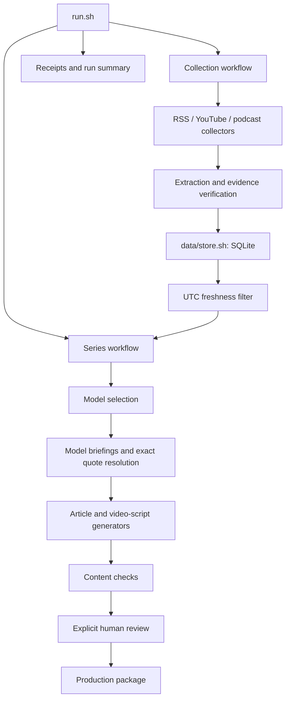

# Problem Set 4 Student Submission

> **ACADEMIC PRACTICE ONLY — MIT 1.125, Problem Set 4**
>
> This repository documents an educational exercise in Agentic AI. Its code, evidence samples, editorial analyses, draft articles and video scripts are provided to demonstrate the development process, technical decisions, learning outcomes and limitations.
>
> The editorial materials are historical academic drafts, not final journalistic publications. The three briefings were reviewed for internal academic use, not approved as published articles.
>
> The project achieved 137/137 offline tests but did not complete the two required successful end-to-end live runs (0/2). No Substack articles or YouTube videos were formally published.
>
> Results must not be interpreted as validation of a production-ready editorial system. Third-party sources retain their respective rights.

**Student:** Guevara Cruz
**GitHub account:** guevaracruzcv
**Submission repository:** [guevaracruzcv/ps04](https://github.com/guevaracruzcv/ps04), confirmed by the researcher. The course `origin` remains [onexi/ps04](https://github.com/onexi/ps04); uploads target the separate `submission` remote.
**Deadline:** October 16, 2026, 5:00 PM Boston (America/New_York; 21:00 UTC).
**Status:** Development closed by researcher decision. This submission honestly documents an incomplete project.

The [original course README](README.md) and [architecture specification](ARCHITECTURE.md) are preserved. **137/137 offline tests passed. Three documented Run 1 attempts failed. Zero of two required successful end-to-end runs completed.** Three briefings are approved for internal academic use under the researcher's final submission instruction. That approval does not authorize complete articles, videos or publication; historical approval records remain unchanged.

## Topic and Audience

- **Publication name:** AI & Public-Sector Capability.
- **Topic:** Artificial intelligence, public-sector employment, workforce transformation and institutional capabilities.
- **Audience and assumed knowledge:** Public-sector leaders, policymakers, digital-transformation managers and development practitioners, especially in small and developing states. Familiarity with public administration is assumed; specialist AI engineering is not.
- **Central question:** Who is positioned to benefit from AI in public administration, who risks being left behind, and how should governments respond?
- **Purpose:** Help readers examine AI claims, distinguish task exposure from institutional outcomes, and ask better adoption and governance questions.
- **Scope and exclusions:** Employment, skills, participation, accountability and implementation capacity; relevant infrastructure/environmental constraints under Policy V2. Exclude general technology promotion, unsupported causal conclusions and unverified country-specific claims. International evidence does not establish outcomes in Cabo Verde.
- **Reason to return and voice:** Connected, cautious, explanatory analysis of new developments, competing interpretations and implications as evidence changes.

## Published Series

Titles identify consolidated academic briefings, not publications. Earlier files in `editorial/drafts/` and `writing/video_scripts/` are historical drafts, not validated outputs of the three failed attempts.

| Piece | Academic briefing | Substack article | Audience-facing YouTube video |
| --- | --- | --- | --- |
| 01 | AI's public-sector promise is shaped by capability, not just automation | Not published | Not published |
| 02 | Public-sector AI claims need context, controls and human accountability | Not published | Not published |
| 03 | From AI pilots to public value: build capacity, test carefully and keep people accountable | Not published | Not published |

**Separate 4-6 minute technical demonstration:** [Watch the narrated technical demonstration (OneDrive; reported duration 6:00)](https://1drv.ms/v/c/a6a91cb71160b1a9/IQDjf70ANiv3RY4SJoVE4Rp7AfjGKRDAuxZqGq-f0R0uxos?e=ICQycn). Recorded and shared by the researcher. Access for external reviewers has not been independently verified. The [older recording runbook](docs/TECHNICAL_DEMO_RUNBOOK.md) is only a guide, not the demonstration video.

## Setup and Execution

The implementation uses Windows/Git Bash, Python and its standard library (including SQLite), FFmpeg/FFprobe, `yt-dlp`, and the OpenAI Python SDK. Inspected local versions: Python 3.14.7, `openai` 3.20.0 and `yt-dlp` 2026.8.19. These describe the inspected environment, not a portable dependency lockfile. Bash, Python, FFmpeg and FFprobe must be on PATH.

Installation instructions for a separately authorized setup, from Git Bash:

```bash
python -m venv .venv
source .venv/Scripts/activate
python -m pip install openai==3.20.0 yt-dlp==2026.8.19
```

No installation or execution was performed for submission preparation. The required live command, from the repository root, is `bash run.sh`. It collects network material and can incur costs: it is documented, **not authorized for execution**. The later handoff command is `bash run.sh --package runs/RUN_ID`; none of the failed runs qualifies for packaging. Historical collection-only and offline replay modes are distinct from successful editorial runs.

`OPENAI_API_KEY` is the credential variable consumed by `OpenAI()`. The local alias `PS04_OPENAI_API_KEY` is not automatically mapped by the adapter. Optional SDK settings are `OPENAI_PROJECT_ID` and `OPENAI_ORG_ID`. Never commit values or secret environment files. Live operation requires explicit `PS04_ENABLE_MODEL_CALLS=1`, `PS04_ALLOW_COLLECTION=1` and `PS04_MODEL`; recorded live editorial calls used `gpt-6-luna`. A separate historical podcast transcription helper specifies `whisper-1`; no new transcription is part of this submission.

`PS04_EVIDENCE_DB` can select an allowed store; the managed default is `data/evidence/contract_v2/evidence.db`. Other controls include `PS04_RUN_DIR`, `PS04_OFFLINE_CONTRACT_RUN` and `PS04_TEST_MIRROR_ROOT`. Test fixtures cannot become live evidence.

Settings are retained in [project.json](config/project.json), [RSS sources](config/sources.json), [active collection sources](config/active_sources.json), [podcast sources](config/podcast_sources.json), [active policy binding](config/active_editorial_policy.json), and four files under `prompts/`. Managed runs snapshot configuration, policy, prompts and human records. Faithful replay also requires the local immutable evidence cache and assets. The proposed small public upload is an inspection sample, not the full recovery archive; clean-clone end-to-end execution is **not demonstrated**.

## Architecture and Manual Handoffs



All 16 required Bash files have nonempty working-tree implementations. Bash entry points preserve component boundaries and coordinate focused Python helpers. This inventories implementation; it does not claim all live stages completed.

| Required file | Responsibility |
| --- | --- |
| `run.sh` | Initialize, coordinate and report a run |
| `workflows/collect_sources.sh` | Coordinate collection, extraction, storage and filtering |
| `workflows/create_series.sh` | Coordinate selection, briefs, drafts and checks |
| `collectors/fetch_feeds.sh` | Discover RSS written candidates |
| `collectors/fetch_youtube.sh` | Discover configured YouTube sources |
| `collectors/fetch_podcasts.sh` | Discover podcast episodes and enclosure URLs |
| `processing/extract_content.sh` | Substantive text, media and timed evidence |
| `processing/filter_items.sh` | Inclusive UTC 30-day eligibility and exclusions |
| `data/store.sh` | Persistent SQLite init/upsert/list/get interface |
| `editorial/select_items.sh` | One reasoned ACCEPT/REJECT/DEFER per eligible pair |
| `editorial/create_briefs.sh` | Three arguments with explicit evidence-bound claims |
| `content/write_articles.sh` | Article drafts and claim manifests |
| `content/write_video_scripts.sh` | Scripts from the same briefs and evidence |
| `review/check_content.sh` | Integrity, references, dates and coverage checks |
| `publishing/prepare_package.sh` | Require current passing review and human approval |
| `reporting/summarize_run.sh` | Stage outcomes, coverage, costs and remaining work |

JSONL carries records; JSON receipts/manifests preserve stage outcomes. SQLite `items`, `versions` and `observations` preserve identities, immutable versions and ingestion history. `data/store.sh` owns the persistent database interface; source assets and run snapshots are separate. SHA-256 binds text, media, segments and requests/responses. Legacy versions may be text hashes; evidence-v2 binds relevant source metadata and asset hashes while excluding retrieval time. A changed retrieval timestamp alone is not changed evidence.

RSS discovery uses MIT AI News. Podcast feeds include IMF, Reuters and World Bank, but only verified matching archived audio/transcripts supply reusable substantive evidence; unmatched candidates remain unprocessed. YouTube collection targets SIGMA and FCT&L. Five institutional written sources are direct-webpage extraction, not proof of RSS discovery. Media locators preserve original segment IDs and timestamps; captions remain navigation evidence unless appropriately human-verified.

Mission 26 resolves model-selected, exact-version passage IDs deterministically from immutable text. Mission 30 scopes selection to eligible item/version pairs, diagnoses missing/unexpected/duplicate decisions and preserves raw selection output. Mission 32B verifies archived YouTube identity, versions, safe paths and hashes before reuse, retaining original provenance instead of fabricating a new download. Application logic and validators remain unchanged in this submission.

Manual production would require final factual/context review, current eligibility checks, approved complete articles/scripts, passing bound content review and explicit approval before packaging. Then produce three 3-5 minute videos in Google Vids or HeyGen; review consistency and attribution; publish three approximately 600-900 word Substack articles with shareable access; upload paired videos; cross-link and record actual URLs. These actions are **not completed or authorized here**.

## Evidence and Runs

The [public evidence sample](docs/submission_evidence.json) includes three actual summaries, selected receipts, human decisions, a representative source of each required type, the third failure references, and recorded offline test results. Original paths and hashes identify source records. Labelled excerpts do not replace complete transcripts, original provider responses or source media.

| Run 1 attempt | Actual UTC start (2026-10-14) | Result | Elapsed | Actual API cost |
| --- | --- | --- | --- | --- |
| `editorial-live-064ea894fd3d49a981b19dca77a0729b` | 19:02:22 | Failed selection: 37 decisions for 38 eligible pairs; 36 exact matches, 2 missing, 1 unexpected HardFlow pair | 104.201623 s | Not fully known |
| `editorial-live-d1a0697d39204523a726bac648b59491` | 21:01:49 | Failed extraction/collection: YouTube `1FeLhg9HqfE` HTTP 403 | 40.825985 s | Not fully known |
| `editorial-live-dde15262d0754684901d851f459baab6` | 22:13:27 | Selection 18 ACCEPT / 8 DEFER / 12 REJECT for 38 eligible; failed `create_briefs` | 126.521346 s | Not fully known |

Original local records are `runs/<run_id>/run.json`, `summary.json`, `logs/`, `model_requests/` and available `model_responses/`. The first selection lacks preserved raw provider `output_text`; later preservation does not retroactively repair that gap. The third briefing response preserves raw output and a matching request hash.

The third failure consists of **two references in `01-c3`** to MIT Sloan's Kaiser Permanente article, item `feed:cc11de4a9b0277b37619`, version `9588975e3ccf114e6eae2396859c6ec8e1df2c27d2aed975e10bcfea70dac351`. It is ACCEPT but assigned only to `02` and `03`. Valid selectors quoted in briefing `01` violate the assignment contract. The unchanged validator correctly rejected the response. No correction or further live attempt is included.

**Successful required end-to-end runs: 0/2.** All attempts occurred on October 14; successful different-day repeatability was not demonstrated. Draft/script generation and content checks were not reached in these attempts. Missing outputs are not successful empty stages.

Earlier collection-only runs `collect-20261011T163942Z-2489` and `collect-20261011T164724Z-2629` recorded 52 then 54 items; the latter had 52 unchanged and two new. The first omitted YouTube due to configuration. Offline replays `replay-20261011T160340985008Z` and `replay-20261011T160512721898Z` recorded 12 new then 12 unchanged versions. These demonstrate component-level deduplication/recovery, not full editorial success. Fictional starter examples and fixtures are not collected evidence.

Summaries record 38 eligible distinct items from seven organizations: 34 written, two podcasts and two YouTube items. Discovery labels identify 29 RSS and five direct-webpage items; a separate comparison against candidate files from the first two failed attempts corroborated 27 RSS labels, leaving two uncorroborated by those specific files. Do not infer RSS discovery from `kind=feed` alone. Organizations are Harvard, MIT, World Bank, IMF, Reuters, SIGMA and FCT&L; MIT Sloan counts with MIT. World Bank pieces drawing on one report are not independent corroboration of its underlying claims.

The October 14 window is September 15-October 14 inclusive. Publication dates and collection dates are distinct. HardFlow (September 14) is ineligible; the September 16 IMF podcast and two MIT RSS items expire October 16. After that, this archive lacks its second eligible podcast. Historical academic briefings are not automatically fresh publication evidence. No dates are changed to meet the deadline.

Media/databases remain local and in verified external backups, including Mission 33's `20261014T214841Z_run1_retry2_preflight`. SIGMA media SHA-256 is `eb69c59f2468d18123fdeeb31d1246b1a29c0f903c4ac1304d7a493766c2bcf5`, with 4,788 timed segments. Public samples retain original publisher/media URLs, paths and hashes. Retrieval would use original URLs only when separately authorized and accessible; a fresh download must not be assumed to match the archived version. Access restrictions must not be bypassed. Complete preserved assets would need a separate reviewed distribution arrangement; full public replay is not claimed.

Summary `known_cost_usd: 0` is a known subtotal, **not a zero total bill**. Receipts retain token usage with unknown costs. Earlier dashboard spending was not reconciled to individual calls. Actual API costs are not fully known; no bill or price estimate is invented.

## Editorial Review

The active [Policy V2](config/editorial_policy.md) is bound by [active policy state](config/active_editorial_policy.json). [V1](config/editorial_policy_v1.md) and the [V2 proposal](config/editorial_policy_v2.md) retain historical wording; the proposal heading is not the active-state authority. All four stage prompts remain under `prompts/`.

October 11 human review confirmed V1's nine ACCEPT, two DEFER and one REJECT. Explicit V2 approval changed the environmental data-center item from REJECT to DEFER; 11 decisions were carried forward. Affected saved recommendations are `runs/editorial-prep/ai_recommendations_v1.jsonl` and `ai_recommendations_v2.jsonl`. This historical editorial revision is not a full successful run. The public sample preserves the human event, approval and all 12 V2 decisions.

| Reviewed source | AI judgment | Recorded human comparison |
| --- | --- | --- |
| Harvard employment article | ACCEPT: challenges simplified unemployment predictions | Confirmed; retain attribution and uncertainty |
| MIT Sloan labor agreement | ACCEPT: worker participation perspective | Confirmed; private healthcare is not government outcome evidence |
| World Bank development article | ACCEPT: developing-economy perspective | Confirmed; no unsupported country-specific conclusion |
| MIT AI in academia | DEFER: primarily higher education | Confirmed; public-administration relevance insufficient |
| MIT humanistic inquiry | DEFER: empirical linkage needs review | Confirmed; interpretation is not causal evidence |
| MIT data-center environment article | V1 REJECT; V2 DEFER | Human revision: infrastructure may be relevant but needs verification |

Corrections remain in `editorial/human_review_m14/`, `human_review_m16/`, `human_review_m18/`, `human_review_m19/` and `human_review_m22/`. Mission 22 consolidated three briefs and seven approved correction packages: narrowed causal claims, labelled planned designs as plans, and described SIGMA polling as participant responses rather than a representative civil-service survey. Its historical complete-content approval remains PENDING. The final submission instruction authorizes **internal academic use of the three briefings only**, without rewriting those records or approving publication. Audio review scopes are limited; captions do not automatically establish public verbatim quotations.

A sample trace, not a published claim: consolidated briefing `01-c1` cites World Bank item `feed:48f774f0bb11de5c34ef`, version `293f5c7caf77f87f5aedea357a654b5b9cae5329ca5d98b9fd7ba3d6c2a6cb3c`, with the exact passage beginning 'In much of the developing world, the problem is too few skilled workers'. The sample retains its decision, claim, source URL, version and text hash. **Published-claim trace: Not completed**, because no article was published.

## Tests and Limitations

Mission 32B recorded **137/137 offline regression tests passed** in 96.147 seconds: 115 prior tests plus 22 new media-reuse tests. The focused suite passed 50/50 in 78.742 seconds. Tests used an external mirror, historical-path relocation, network denial, removed credentials and mocked external interactions. The public sample includes the original report's hash and selected results. Tests were not rerun for submission preparation.

Tests cover contracts, exact quotations, eligible-set selection, versions, reuse safety, dates, storage and failures. They do not prove model compliance, remote accessibility, successful synthesis or publication readiness. Historical archive coupling, path relocation and omitted assets limit clean-clone test reproduction. No full portable dependency lockfile was recorded. See [upload review](docs/GITHUB_UPLOAD_REVIEW.md).

## Reflection

The strongest editorial insight was that potential task automation and institutional benefit are different questions. Employment reporting, worker participation and development evidence motivate examining implementation, skills and institutional capacity together; the corpus does not establish their causal effects in public administration.

The main failure was the gap between deterministic component validity and reliable end-to-end behavior. Selection validation caught missing/ineligible decisions, media verification exposed collection fragility, and briefing authorization caught a relevant but wrongly assigned source. These refusals protected integrity but left final deliverables incomplete.

The tradeoff was strong provenance and immutable evidence versus large model requests and local archive complexity. Lossless compaction, exact selectors and verified reuse reduce some risks while retaining context and portability costs. Offline tests cannot substitute for live completion or human interpretation. A future project should test synthesis under explicit per-piece permissions earlier and reserve time for publication and demonstration. This is reflection, not authorization to resume engineering.

## Final Deliverable Disclosure

- Three internally approved academic briefings: available as historical analyses.
- Successful end-to-end runs on different days: **Not completed (0/2)**.
- Three Substack articles and three audience-facing videos: **Not published**.
- Separate technical demonstration: **Recorded and shared** — [OneDrive video (reported 6:00)](https://1drv.ms/v/c/a6a91cb71160b1a9/IQDjf70ANiv3RY4SJoVE4Rp7AfjGKRDAuxZqGq-f0R0uxos?e=ICQycn). External reviewer access remains unverified.
- Final reviewed production package from these attempts: **Not completed**.
- Reviewed final GitHub academic submission: **Completed** to [guevaracruzcv/ps04](https://github.com/guevaracruzcv/ps04), branch `main`, following explicit researcher approval of the 86-path inventory. The existing LICENSE history was preserved. This upload does not complete the missing academic deliverables.
- Actual API cost reconciliation: **Not completed**.

The original assignment requirements were not fully met. Submission documentation records the work and its limits without inventing deliverables.
